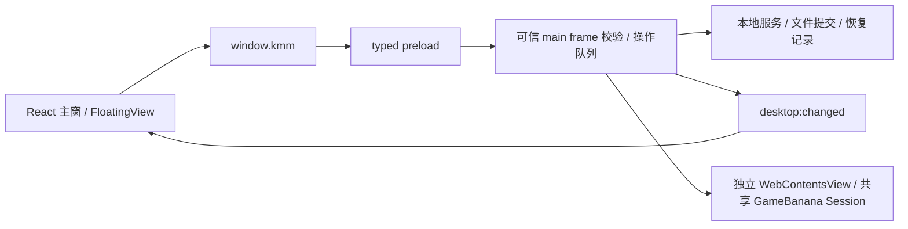

# 前端功能与 GUI 对接文档

更新日期：2026-10-15；源码版本 **0.0.5**。沿用旧文件名，内容已从 P2–P4 待办更新为当前交接基线，供后续 Agent 调整布局及 GUI 行为。本文描述已有功能，不启动游戏、打包或发布。

先读本文，再查[桌面接口文档](桌面接口文档.md)和[自动接口清单](desktop-api-inventory.json)。当前 **99 个异步 API + 1 个事件：93 个 API 有 renderer 消费者，6 个仅兼容保留**。清单列出精确参数、Result.value、IPC、handler、服务和实际消费者；类型以当前源码为准。

桌面接口文档逐行列出“对应功能 / 实际业务效果”，并展开 operateMod、下载动作、配置策略、清理动作等分支。下面的页面总表说明功能入口，逐接口表说明调用实际会读取、准备或提交什么；两者应一起交给 GUI Agent。

## 1. 底层框架与入口

生产应用没有 HTTP 产品后端。renderer 不直接访问文件系统、Electron、Cookie 或网页 DOM；远程网页没有管理器 bridge。测试 fixture/CDP driver 不是产品接口。

| 层 | 当前入口 | 用途 |
| --- | --- | --- |
| 页面 | [main.tsx](../src/renderer/main.tsx)、[App.tsx](../src/renderer/App.tsx)、[FloatingView.tsx](../src/renderer/FloatingView.tsx) | 同入口按 #floating 选择浮窗；主窗有标题栏占位，保留原生窗口控制，标题文字隐藏，左上 KIRIU 品牌 |
| GUI | [styles.css](../src/renderer/styles.css)、[ui.tsx](../src/renderer/ui.tsx)、[theme.tsx](../src/renderer/theme.tsx)、[sidebar-layout.ts](../src/renderer/sidebar-layout.ts) | 样式、SVG、反馈、主题和侧栏尺寸 |
| 类型 | [contracts.ts](../src/shared/contracts.ts)、[inspections.ts](../src/shared/inspections.ts)、[import-workflows.ts](../src/shared/import-workflows.ts)、[preset-workflows.ts](../src/shared/preset-workflows.ts) | DesktopAPI、DTO 和分类型任务结果，不在页面另造冲突类型 |
| 桥接 | [ipc-contracts.ts](../src/shared/ipc-contracts.ts)、[preload](../src/preload/index.ts)、[main/index.ts](../src/main/index.ts) | type-only 对照、typed invoke、权限、原生选择/确认、队列、日志和通知 |
| 业务 | [项目技术说明](项目技术说明.md)和清单 serviceCalls | Mod、依赖、预设、配置、导入、恢复和更新由主进程执行 |

## 2. 页面与功能总表

App 用 React state 导航，没有 URL router。page 为 mods/market/downloads/preferences/presets/conflicts/recovery。BusinessPageKind 保留后三者枚举，但实际 BusinessPage 参数仅接受 kind:'presets'；冲突与恢复已有专用页面。

| 页面 / 功能 | 当前能力 | 组件 / 主要接口 |
| --- | --- | --- |
| 角色概览 | 搜索角色、分类、封面、数量/有效启用数、全部/未分类、本地导入 | CharacterGallery；scanMods、characterCovers、chooseCharacterCover、ModImportPanel |
| Mod 列表和详情 | 搜索、分类/角色/状态、收藏/标签筛选、排序、多选、启停/改名/分类/替换/移除、封面、INI、来源/历史、只读网站信息 | ModPage；operateMod、replaceMod、deleteMod、cover/chooseCover、addGroup 及子面板 |
| 批量与互斥组 | 筛选全选、隐藏选择提示、批量启停/分类、加入预设、明确互斥候选、组保存/删除 | ModBatchTools、ExclusiveGroupsPanel、ExclusiveChoiceForm；batchMods、saveExclusiveGroup、deleteExclusiveGroup、addModsToPreset |
| F06 依赖 | Mod/组件最低版本、游戏版本、声明来源/备注、拟操作检查 | ModOrganizationPanel；operateMod(requirements)、dependencyCheck |
| F09/F10 收藏标签 | 保存收藏/标签，参与筛选/排序 | ModOrganizationPanel、ModPage；operateMod(favorite/tags) |
| 来源与 F08 手动更新 | 编辑来源/版本/人工兼容状态、历史；网站候选、确认后定向更新任务 | ModProvenancePanel、ModUpdatesPanel；openModSource、checkModUpdates、prepareModUpdate |
| 获取Mod | 浏览器式前进/后退/SVG 刷新/首页、只读地址、加载/错误、下载入口 | ModBrowserPage；setModBrowser、modBrowserStatus、navigateModBrowser |
| 下载进度 | 两游戏任务、完整包、历史、取消/重试、查看包、目录确认、新装预检、定向更新、查看已安装项 | ModDownloadsPage；modDownloadAction、modDownloadInstallPlan、ModImportPanel |
| F01 导入预检 | 本地文件夹/ZIP/7z/RAR 与下载共用预检；子集/名称/角色目录、重复默认跳过、空间与逐项结果 | ModImportPanel；prepare/revise/commit/discardModImport、modImportFiles |
| F02 普通预设 | 当前启停捕获、成员/名称编辑、最终状态/联动/缺失预览、互斥/排除、确认应用/删除 | BusinessPage、PresetApplyPanel；presets/savePreset/deletePreset、prepare/commitPresetApply |
| F05 独立配置 | 选定 INI 捕获、复制、只读保存副本、活动/dirty 检查、保存或备份后切换 | ProfilePanel；profileScope/Capture/Duplicate/Status/PrepareApply/Apply、readProfileIni |
| F12 清单迁移 | ID/站点下载链接/完整树哈希、导出预览、导入匹配/缺失名称、显式不同哈希替代、待补齐记录、可选非活动 INI | PresetExportPanel、PresetImportPanel；六项 preset-manifest 方法，不自动下载或启用 |
| F07 候选冲突 | 后台扫描、type/hash、分页片段/条件/资源/未知规则、定位 Mod/INI、手动停用/互斥 | ConflictPage；startConflictInspection、conflictDetails、revealManagedLocation、batchMods、saveExclusiveGroup |
| F04 备份恢复 | 后台空间/完整性/引用盘点、手动备份、保护、恢复预览/确认、永久清理预览/确认/逐项进度/继续/撤回 | RecoveryPage；startRecoveryInventory、createBackup、恢复/清理/保护 API |
| 设置：常规 | 两游戏 XXMI/游戏/Mod 路径、检测/选择/保存、同步、官方空根部署/进度、运行库；请求刷新/网页/发布页/退出、托盘 | SettingsPage、DesktopSettings、App；局部保存、部署和桌面 API |
| 设置：F13 游戏环境 | 轻检查、受限发现、原生选择、候选/范围、路径差异预览、原生确认、精确回退及记录 | EnvironmentPanel；checkGameEnvironment、chooseGameInstallation、prepareEnvironmentRepair、applyEnvironmentRepair；共用 InspectionJob |
| 设置：进程兼容测试 | 导入 SDK 本地记录、核对当前环境，展示通过/失败/证据不足/过期/未知 | CompatibilityPanel；compatibilityStatus、importCompatibilityEvidence；不启动游戏，不改人工验证 |
| 设置：F03 诊断 | 已保存上下文事实、pass/warning/error/unknown/skipped、页面跳转、默认脱敏 Markdown/JSON 预览/导出 | DiagnosticsPanel；startDiagnostics、previewDiagnosticExport、exportDiagnosticReport |
| 设置：关于 | 当前版本、可配置更新源、检查/说明、确认下载/校验、退出安装 | AboutPage、AppUpdatePanel；desktopStatus、saveDesktopPreferences、四项更新 API |
| F11 排序 | 各游戏最多三项显示排序，稳定兜底/滚动锚点 | useModSort、ModSortControl、VirtualList；无排序 IPC |
| 快速管理浮窗 | 共享游戏选择、搜索名称/角色、刷新、依赖确认后启停、打开主窗/关闭浮窗 | FloatingView；readSettings、selectGame、scanMods、operateMod、showMain、floating |
| 日志/中断恢复 | 白名单日志、提交/备份关联；恢复页处理未完成记录 | 当前无日志页或日志读取/导出 IPC，不把日志作为业务状态 |

两游戏网页固定为绝区零 games/19567、终末地 games/21842。共享浏览器/历史/Cookie；库、预设、图、下载任务 gameId/根按游戏隔离。旧 desktop.marketUrl 不控制新入口。

### 页面存活和跳转

- 启动读设置，有当前游戏已保存 Mod 根进入库，否则设置；错误可重试。游戏选择通过 selectGame 保存并同步主/浮窗。
- scope:null 为角色概览；all/unclassified/character(name) 为列表。从有 scope 的列表去获取Mod/下载，会 hidden 保留 ModPage 和详情草稿；active:false 清批量选择、关闭导入面板、取消全局 busy 上报。
- 去其它业务页会卸载库组件。设置页常驻 hidden；诊断也常驻，其任务可继续完成。About/AppUpdatePanel 用 hidden 暂停状态轮询。当前没有所有页面的持久草稿库。
- 游戏或已保存 Mod 根变化，App 清 scope、INI ID、下载跳转 initialModId。身份按游戏、根、稳定 ID；不能用整份 Mod 对象引用判断换身份。
- 下载查看已安装：先切任务游戏，再打开全部 Mod 和目标 ID；只在任务根等于该游戏当前根时可用，不能套当前侧栏游戏。
- 冲突定位传 IniNavigationTarget={gameId,modId,fileRelativePath,line,expectedDigest}；摘要改变应重新读取，不能沿旧行号直接写入。

## 3. 组件直接调用接口

下表从当前导出组件声明提取，为真实 props；父子回调不经过 IPC。onBusy 上报当前提交，不替代后端队列。onUpdated 返回实际快照；onComplete/onImported 返回本次回执，父层采用或重读。

App.busy 当前是页面回调更新的 boolean，不是并发任务计数器；长读取由 InspectionJob 管理，不应因此锁死导航。BusinessPage 保留 onRestored 参数但当前未使用，实际恢复完成回调在 RecoveryPage；不要从参数名推断不存在的页面行为。

<!-- renderer-components:start -->
| 组件（源码） | props 类型（精确声明） | 当前父组件文件 |
| --- | --- | --- |
| [AboutPage](../src/renderer/AboutPage.tsx) | `{hidden:boolean;onBusy:(busy:boolean)=>void}` | App.tsx |
| [AppUpdatePanel](../src/renderer/AppUpdatePanel.tsx) | `{hidden:boolean;onBusy:(value:boolean)=>void}` | AboutPage.tsx |
| [BusinessPage](../src/renderer/BusinessPage.tsx) | `{kind:'presets';gameId:GameId;onBusy:(busy:boolean)=>void;onRestored:()=>Promise<void>}` | App.tsx |
| [CharacterGallery](../src/renderer/CharacterGallery.tsx) | `{gameId:GameId;savedRoot:string;onBusy:(busy:boolean)=>void;onSettings:()=>void;onOpen:(scope:CharacterScope)=>void}` | App.tsx |
| [ConflictPage](../src/renderer/ConflictPage.tsx) | `{gameId:GameId;onBusy:(value:boolean)=>void;onMod:(id:string)=>void;onIni:(target:IniNavigationTarget)=>void}` | App.tsx |
| [DesktopSettings](../src/renderer/DesktopSettings.tsx) | `{hidden:boolean}` | App.tsx |
| [DiagnosticsPanel](../src/renderer/DiagnosticsPanel.tsx) | `{gameId:GameId;onNavigate:(target:'settings'\|'recovery'\|'mods'\|'presets')=>void}` | App.tsx |
| [EnvironmentPanel](../src/renderer/EnvironmentPanel.tsx) | `{gameId:GameId;hidden:boolean;onBusy:(busy:boolean)=>void;onSaved:(settings:Settings)=>void}` | App.tsx |
| [CompatibilityPanel](../src/renderer/CompatibilityPanel.tsx) | `{gameId:GameId;hidden:boolean}` | EnvironmentPanel.tsx；常规设置环境卡片之前 |
| [ExclusiveChoiceForm](../src/renderer/ExclusiveChoiceForm.tsx) | `{conflicts:ExclusiveConflict[];library:LibrarySnapshot;busy:boolean;onConfirm:(choices:ExclusiveChoices)=>void;onCancel:()=>void;confirmLabel?:string}` | ModBatchTools.tsx、PresetApplyPanel.tsx、ProfilePanel.tsx |
| [ExclusiveGroupsPanel](../src/renderer/ExclusiveGroupsPanel.tsx) | `{library:LibrarySnapshot;selectedIds:string[];busy:boolean;onBusy:(busy:boolean)=>void;onUpdated:(library:LibrarySnapshot)=>void}` | ConflictPage.tsx、ModPage.tsx |
| [IniEditor](../src/renderer/IniEditor.tsx) | `{target?:IniNavigationTarget;gameId:GameId;modId:string;onClose:()=>void;onBusy:(busy:boolean)=>void}` | App.tsx |
| [ModBatchTools](../src/renderer/ModBatchTools.tsx) | `{library:LibrarySnapshot;visibleIds:string[];selectedIds:string[];busy:boolean;onBusy:(busy:boolean)=>void;onSelection:(ids:string[])=>void;onUpdated:(library:LibrarySnapshot)=>void}` | ModPage.tsx |
| [ModBrowserPage](../src/renderer/ModBrowserPage.tsx) | `{gameId:GameId;onDownloads:()=>void}` | App.tsx |
| [ModDownloadsPage](../src/renderer/ModDownloadsPage.tsx) | `{modsRoots:Record<GameId,string>;onLibrary:(game:GameId,id:string)=>void;onBrowse:()=>void}` | App.tsx |
| [ModImportPanel](../src/renderer/ModImportPanel.tsx) | `{gameId:GameId;source:ImportSource;onClose:()=>void;onComplete:(r:ImportReceipt)=>void;onBusy?:(busy:boolean)=>void}` | CharacterGallery.tsx、ModDownloadsPage.tsx、ModPage.tsx |
| [ModOrganizationPanel](../src/renderer/ModOrganizationPanel.tsx) | `{gameId:GameId;mod:ModEntry;library:LibrarySnapshot;busy:boolean;onBusy:(busy:boolean)=>void;onUpdated:(library:LibrarySnapshot)=>void}` | ModPage.tsx |
| [ModPage](../src/renderer/ModPage.tsx) | `{gameId:GameId;savedRoot:string;onBusy:(value:boolean)=>void;onSettings:()=>void;onIni:(id:string)=>void;scope:CharacterScope;onBack:()=>void;active?:boolean;initialModId?:string}` | App.tsx |
| [ModProvenancePanel](../src/renderer/ModProvenancePanel.tsx) | `{gameId:GameId;mod:ModEntry;busy:boolean;onBusy:(busy:boolean)=>void;onUpdated:(library:LibrarySnapshot)=>void}` | ModPage.tsx |
| [ModUpdatesPanel](../src/renderer/ModUpdatesPanel.tsx) | `{gameId:GameId;ids:string[];busy:boolean;onBusy:(busy:boolean)=>void}` | ModPage.tsx |
| [PresetApplyPanel](../src/renderer/PresetApplyPanel.tsx) | `{gameId:GameId;preset:Preset;library:LibrarySnapshot;busy:boolean;dirty:boolean;onSave:()=>Promise<void>;onApplied:()=>Promise<void>;onBusy:(value:boolean)=>void}` | BusinessPage.tsx |
| [PresetExportPanel](../src/renderer/PresetTransfer.tsx) | `{gameId:GameId;preset:Preset;busy:boolean}` | BusinessPage.tsx |
| [PresetImportPanel](../src/renderer/PresetTransfer.tsx) | `{gameId:GameId;preset?:Preset;busy:boolean;onBusy:(value:boolean)=>void;onImported:(receipt:PresetImportReceipt)=>Promise<void>}` | BusinessPage.tsx |
| [ProfilePanel](../src/renderer/ProfilePanel.tsx) | `{gameId:GameId;preset?:Preset;name:string;library:LibrarySnapshot;busy:boolean;onBusy:(v:boolean)=>void;onPresets:(p:Preset[])=>void;onApplied:()=>Promise<void>}` | BusinessPage.tsx |
| [RecoveryPage](../src/renderer/RecoveryPage.tsx) | `{gameId:GameId;onBusy:(busy:boolean)=>void;onRestored:()=>Promise<void>}` | App.tsx |
| [SettingsPage](../src/renderer/SettingsPage.tsx) | `{ initialSettings:Settings; gameId:GameId; hidden:boolean; onSaved:(settings:Settings)=>void; onBusy:(busy:boolean)=>void }` | App.tsx |
<!-- renderer-components:end -->

| 工具 / helper | 接口与约束 |
| --- | --- |
| useInspectionJob(game) | job/error/start/cancel/clear/setError；start 接收 ()=>Promise<Result<InspectionJob或null>>；450ms polling；generation/game 检查，清除/卸载取消所拥有的运行任务 |
| InspectionProgress | job:InspectionJob或null、error:string、onCancel:()=>void；固定游戏/根/时间、阶段和过期提示 |
| unwrap / guarded | unwrap 解包或抛错；guarded 接收可选 DependencyConfirmation 的闭包，只对 DEPENDENCY_CONFIRMATION 的 warning 明确确认重试，block 不可越过 |
| OperationFeedback / Icon | error/message/quiet 与 aria-live；SVG kind 为 settings/game/folder/grid/search/plus/panel/download/back/forward/refresh/home |
| useModSort / ModSortControl | 按游戏偏好；控件 value:SortCriterion[]、onChange:(value:SortCriterion[])=>void |
| VirtualList<T> | items/rowHeight/className/itemKey/render；选填 selectedKey/empty/preserveAnchor；超过 160 项虚拟化，行高必须匹配内容，稳定 ID key |
| useSidebarLayout | collapsed/toggle/shellStyle/resizerProps；默认 248、展开 200–380、折叠 64、方向键步进 16、双击重置 |
| 草稿 helpers | mod-draft.ts、mod-provenance-draft.ts、settings-draft.ts：身份/baseline/dirty patch/逐字段接受，不能 setState(latest) 整份覆盖 |

## 4. 交互必须保留的完整流程

### 4.1 F01：本地及下载新装

prepareModImport → InspectionJob → ImportPreview → reviseModImport（修改后）→ commitModImport → ImportReceipt。

source 为 folder/archive 或 download(taskId)。选择器取消返回 null。预检会写归属缓存，effect:'owned-cache'，还未写 Mod 库。显示包内身份、大小、INI 数、角色/目录建议、完整树哈希、重复/关联、阻挡和空间；文件清单每页 100。

改子集/名称/目录/另存副本后重新预检，不复用旧 token。完全重复默认跳过；同名不覆盖，显式另存需不同目标。比较未完成/空间未知额外接受，不能显示无重复或空间充足。主进程提交前重验输入、缓存、库、根、空间与绑定。新项默认停用，不自动创建互斥组/预设或标人工兼容已验证。

原生确认取消 null，保留有效计划。回执逐项区分 imported/existing/skipped/failed/interrupted，同时展示 importedIds 和 errors。discardModImport 在完整条目边界停止剩余项；已完成项保持。空闲关闭先离开面板，再异步清归属缓存；旧请求不能关闭新面板。未知或被中断记录引用的缓存保留。旧 importMods 仅兼容默认原生计划，新装不允许用 retry-install 绕过预检。

### 4.2 原生浏览器、Cookie 与下载

网页是 WebContentsView，不是 iframe。setModBrowser 使用 viewport.getBoundingClientRect 的逻辑坐标，由主进程取整/裁剪，不乘 devicePixelRatio。ResizeObserver、resize、捕获 scroll、侧栏尺寸都需同步；离开/卸载传 null 隐藏并清监听/轮询。当前 600ms polling；旧游戏响应不能覆盖新游戏工具栏。

原生视图位于宿主 DOM 上方，CSS z-index 不能让 HTML 弹窗覆盖网页；需要覆盖时先隐藏原生视图，关闭后恢复区域。工具栏、错误、外链提示改变高度也需重算。地址栏只读；导航仅 back/forward/reload/home/external，没有任意 URL 导航 API。

共享 persist:kmm-gamebanana；持久 Cookie 由 Chromium 保存，会话 Cookie 主进程系统加密补存/恢复；无加密能力不明文降级，退出登录不重放旧会话。GUI 不取 Cookie、不另建游戏 session。外链需可信工具栏显式打开；外部网盘仍手动导入。

最多三项并行下载。ready 是完整包待安装；archiveReady 与 stage 分开，失败/部分安装也可保留完整资源。任务固定 gameId/targetRoot；重启未完成变 interrupted，不自动续装。根变化进入 waiting-directory；install-current 原生确认只改任务根并准备，之后仍需点击预检安装。取消下载与停止导入是两个不同动作。

“重新下载”例外地发起新 DownloadItem 并创建新任务 ID，不是续传/改写旧任务。新安装的新记录保留原游戏、读取该游戏当时已保存根；旧记录和包仍保留。定向更新新记录仍固定 updateTarget.root。“重读 Mod 信息”才在原任务上更新绑定，不悄悄切换该任务根。

定向更新使用 modDownloadInstallPlan 的 updatePreview/configChanges，选一个包内条目后 retry-install；保持原 ID、整理字段、封面、启停，先留旧内容副本。它不是默认停用的新装，目标/根/内容修订固定，不提供改根另装捷径。

### 4.3 普通预设、独立配置与清单

普通预设 dirty 时明确先保存再预览或按已保存版本预览；preparePresetApply 展示最终直接/联动状态、缺失名称、阻挡、互斥。修改互斥/排除后重预览，明确接受版本提示/联动，再 commitPresetApply 原生确认。只变目录启停，不写 INI；取消 null，实际 applied/unchanged/excluded 看回执。

独立配置 profileScope → 选文件 → profileCapture/duplicate；保存副本用 readProfileIni。profilePrepareApply 后明确 backup/save/cancel，profileApply 使用同策略/token/依赖确认，在副本保护下提交 INI、目录和活动引用。未捕获 INI 共享；旧内容修订需适配，不能送普通预设应用接口。

捕获读取已保存的预设成员和磁盘 INI，不采纳 GUI 未保存草稿；无活动配置或捕获当前活动配置时会更新 activeProfile。复制配置不激活副本，清单接收的 INI 也不激活。当前“取消切换”仅关闭前端计划，和调用 profileApply(strategy:'cancel') 消费 token 是不同实现。

清单 preparePresetExport → 预览本地 ID、网站 Mod/File ID、下载链接、完整树 SHA256 → exportPresetManifest 原生保存。配置 ZIP 仅带保存 INI，不打包 Mod 主资源。导入 preparePresetManifestImport → 选择/替代 → revise → commit；唯一完整哈希自动接受，网站身份仅提示，同名不自动匹配。允许明确接受不同/未知哈希替代；缺少时显示名称，可明确保存 missingMods 待补齐；members 只放真实本地 ID。

importPresetReplacement 用原生选择导入默认停用替代，返回逐项 ImportResult，之后重新匹配。清单只保存预设/非活动配置，不应用状态、不覆活动 INI、不自动下载。mod-tree-v1 包含内部路径及原字节，含 INI/图，只忽略外层目录名；网站文件摘要、INI digest、完整树哈希是不同证据。

### 4.4 依赖、互斥、详情与 INI

启停/批量/互斥/预设/替换/移除/恢复/浮窗执行同一依赖规则。warning 的本次 token 不是永久关闭校验；block 不可强行继续。多个互斥拟启用者必须明确选择。候选冲突仅 INI 字面证据，不代表渲染错误，不自动建互斥组。

rename 真改目录并保 ID；metadata 只保存字段，classify 才移动。enabled 含祖先影响，不等同 ownDisabled。替换/移除有恢复副本；本地替换清当前文件 remote，旧绑定留副本。网站信息只读，来源/版本表单仍可编辑。

INI 保存携带读取时 digest；过期拒绝并保留草稿，用户明确重读才丢弃。文本/快捷键是独立模式，切换不自动解析草稿。保留编码/BOM/换行/注释，最终编码含 BOM 上限 4 MiB，不能用字符数判断。保留放弃草稿确认、Escape、焦点约束和关闭后焦点恢复。

### 4.5 诊断、恢复、清理与后台任务

InspectionJob 含固定游戏/路径/时间、warnings、stale、分类型 result。长读取不全局锁导航。共享后台预算两项，同类不同请求拒绝旧结果复用；取消是请求，可能短时仍 running。完成结果最多保留 10 分钟且数量有界，过期需重新读。

恢复先展示 scope/affectedIds/文件差异/空间，再原生确认；完整快照为整根范围。清理先查保护/引用/归属/完整性，原生永久确认后返回持久 CleanupJob，再轮询；IPC.ok 不代表删除完成。continue/undo/cancel 有边界，已删除项不能保证撤回。未知/保护/引用/活动内容不能靠 GUI 勾选强删。

revealManagedLocation 仅受控 ID/reference，没有任意路径删除；import-preparations 可定位/统计，不授权清理。日志只记录白名单结果、计数/ID/提交引用，不附敏感原文。

### 4.6 设置与管理器更新

路径只发 saveGamePaths(game,dirtyPatch)；桌面偏好/更新源发 saveDesktopPreferences(patch)。无改动不发空 patch；省略保留、空字符串清空、undefined 不清空。失败保留草稿；成功仅接受本次提交且等待期间未再编辑的字段。未保存路径不控制库/下载。检测不保存；保存路径不等于 loader 同步/部署/游戏生效。

checkAppUpdate → 展示版本/notes/size → downloadAppUpdate 原生确认 → 下载/SHA256 校验 → ready → installAppUpdate 原生确认 → 退出替换重启。更新源与外部发布页 updateUrl 分开，源变化先保存再检查。源码 canInstall:false 不能用 GUI 解除；与 Mod 下载/导入/恢复清理协调，不接受页面指定包路径/URL/EXE。

### 4.7 F13 路径修复

EnvironmentPanel 按 game key 挂载，随设置页 hidden 保留；首次挂载/切游戏做轻检查，在设置环境可见时对焦点和 settingsChanged 去抖 500ms。轻检查只核对固定名字，不遍历游戏资源；用户“查找候选”或原生选择才受限递归。读任务使用既有两并发/取消/过期机制，不上报全局 busy；预览和提交才上报。

检查/原生选择清除旧报告和预览，候选必须明确选择，范围默认 save。`prepareEnvironmentRepair` → 展示公开差异 → `applyEnvironmentRepair` 的原生确认 → 采用回执 Settings 并重查；取消不提交且可重试。保留 SettingsPage 未保存草稿，不把环境结果直接填入表单。回退同样先预览，再原生确认；预览仅列剩余改动，提交前复核目标与记录，变动后需重读。回退期间阶段为 working，失败为 pending；重启后只显示恢复入口，不自动执行。读取/预览状态不作为永久启动授权。

EnvironmentRepairReceipt.gameId 为实际操作游戏；onSaved 接收最新全体 Settings。不要将环境错误扩散成禁用所有 Mod 管理。完整包/下载旧任务、Mod 根、兼容状态、互斥组与预设保持原有流程。后台检查不抢导航，不启动游戏/XXMI，不发刷新输入。游戏版本及兼容性自动判断本轮不实现。

## 5. 状态、缓存与持久化

| 数据 | 所有者 / 当前寿命 | 调整约束 |
| --- | --- | --- |
| 选中游戏/路径/桌面偏好 | SettingsStore / userData/settings.json；两窗共享 | 采用返回 Settings，event.gameId 不是操作回执 |
| Mod/分组/来源/标签/互斥/活动配置 | 主进程按游戏和根 registry；INI/启停对应实际文件 | 不用 localStorage 替代权威库，采用返回快照/回执 |
| 预设/缺失记录/配置修订 | presets-<game>.json、profiles/<game>/；根绑定 | missingMods 不是成员假 ID，profiles 保留不可变修订 |
| 下载/完整包/准备缓存 | mod-downloads/、import-preparations/ | 卸载不等于取消下载，session/token 不长期持久授权 |
| 主题 | localStorage kmm-theme，day/night | 主窗同步原生栏；支持从按钮中心扩散的主题动画，减少动画偏好使用淡入，不支持 View Transition 时直接切换；夜间悬停保留强调色。当前没有跨窗 storage 实时主题订阅 |
| 侧栏 | kmm-sidebar-width / kmm-sidebar-collapsed | 保留尺寸/键盘/拖拽/重置，联动原生网页区域 |
| 排序 | kmm:display:<game>，version:1，sort 最多三项 | name/importedAt/state/favorite/character/category；空值末尾、名称/路径/ID 稳定兜底；不改文件 |
| 详情/来源/设置草稿 | renderer state + baseline helper | 同身份外部刷新逐字段合并，明确编辑保留；切身份清旧值，不能用新对象引用重置 |
| 搜索/筛选/预设成员草稿 | 页面 state，卸载丢失 | 没有统一持久草稿库；改生命周期须说明保留与确认丢弃边界 |
| selectedIds | ModPage state | 筛选/排序保留隐藏选择并提示；切游戏/根、active:false 清空，按有效 ID 修剪 |
| 图片 | 主进程 ImageCache 每实例 32 MiB/128 项；data URL/lazy img | 按文件身份/时间失效，异步结果校验；不要每次输入读取全库图 |
| 任务/预览/token | 主进程内存与归属缓存 | stale/complete 不代表可以提交；过期重预览，提交再校验 |

onDesktopChange(callback) 返回解除订阅函数。DesktopChange={gameId,settingsChanged} 的 gameId 是通知时当前选中游戏，不是操作参数游戏；settingsChanged 仅提示重读设置。部分页面按 event.gameId 过滤，浮窗每次重读；改统一数据层时用返回 gameId/任务上下文与实际设置核对，保留解绑及竞态保护。取消也可能广播，事件不证明成功。

## 6. 后续 Agent 修改和验证

布局/文案/组件拆分可以在 renderer 调整；保留功能入口、可访问名称/键盘、错误/取消/逐项结果、草稿与 busy。不要用静态演示覆盖生产调用，不隐藏未知/部分结果，不将启动或刷新请求写成游戏加载成功。

若改 DesktopAPI，同步 contracts/ipc-contracts/preload/main/服务/消费者/语义 metadata，重生成清单并同步文档。仅 GUI 消费者行号变化也需要 api:inventory。

| 修改范围 | 针对性检查 |
| --- | --- |
| 页面/接口 | typecheck、api:inventory、api:check、build；相关现有单元测试 |
| 库/详情/批量/互斥/来源 | smoke:mods -- --functional、smoke:priority、smoke:v004；真实目录/草稿 |
| 浏览器/下载/区域 | smoke:mod-browser、smoke:v003；Cookie 改动再 smoke:browser-cookies，真实站点单记 |
| F01 | smoke:imports；重复/子集/名称/目录、原生取消/重试、默认停用、跨页/重启 |
| F02/F12 | smoke:preset-workflows；dirty、缺失名称、不同哈希替代、取消/过期、INI 非活动 |
| 独立配置/依赖/更新 | smoke:v004；真实文件/修订，不只检查请求返回 |
| 诊断/恢复/冲突/排序 | smoke:second-batch；范围、保护/引用、逐项清理、定位、虚拟化 |
| 设置/关于/标题栏 | smoke:v003、smoke:window-chrome；局部保存 helper 测试、错误、源模式禁安装 |

运行窗口前 build，start 仅使用已有 dist；测试用绝对 KMM_DATA_DIR 指向 .run-data 隔离数据。布局改 DOM 后更新脚本定位，保留业务断言，不能删失败断言充数。本次不增加运行游戏/XXMI、打包、Release 或推送权限。

## 7. 当前证据和交接边界

本交接功能的开发起点为本地 agent/main 的 12beff7，已经包含 F01–F12、F13 R1–R3 和已合并的 UI 改动。`agent/process-recovery-compatibility` 新增进程兼容记录卡片与两项 API，交付目标为回流并推送 `agent/main`，实际提交与推送状态以 Git 引用为准；开始时 GitHub 连接失败，未把缓存远程引用表述为当时新同步结果。布局 Agent 应保留当前 99+1 契约、设置路径草稿和两种独立验证语义。

CompatibilityPanel 的 props 为 gameId/hidden，无父级写回回调，只有组件内 busy/error/status/sequence。它在 EnvironmentPanel 前展示；可见、聚焦或 settingsChanged 时去抖核对，旧请求不能覆盖新 game/hidden 状态。导入原生选择器返回 null 后重新核对；错误时撤下此前通过状态。不能将本地记录摘要当远程签名，不能改写人工 Mod verification。只读检查经过主队列，避免和路径保存/修复交叉。

上一轮 F01 门禁 .run-data/import-iteration/2026-10-15-f01/gate.json 记录 **195/195 测试、typecheck、93+1 API、build、七组隔离实际 Electron 窗口通过**，附源码/产物哈希。窗口包含受控 HTTPS/native DownloadItem、双游戏实际文件与原生选择/确认驱动；不等于本轮真实 GameBanana 联调或人工最终体验。历史外部证据保留原范围。

本次仅同步文档；最新文档核验见[接口调整说明](接口调整说明.md)。V01 真实游戏、V02 未覆盖交互/人工体验、V03 新包/实际更新、V04 性能差异归因仍见[后续版本迭代规划](后续版本迭代规划.md)。新 GUI 调整后需重新建立对应窗口证据。

F13 新增环境报告/预览为有界内存缓存；持久记录 environment-repairs/<game>/<id> 保留归属、阶段和配置原字节，environment-staging 为尚未发布的只读准备副本；environment-<game>.json 只是确认后的位置线索，不是写入/兼容授权。GUI 调整后至少重跑 smoke:environment；本轮证据见[路径修复与验收](0.0.4路径修复与验收.md)。
